

  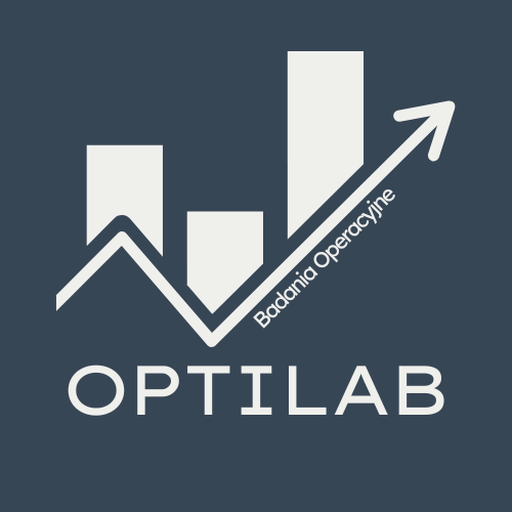

<h1 align="center">OptiLab 🧮</h1>

<b>Badania operacyjne w przeglądarce – po polsku, krok po kroku, bez instalacji.</b>

  <a href="https://giorgioulani544.github.io/OptiLab/"><b>👉 Otwórz aplikację</b></a>

  
  
  
  

---

## ✨ Co to jest?

**OptiLab** to darmowa aplikacja do rozwiązywania zadań z badań operacyjnych i zarządzania produkcją – nowoczesna alternatywa dla programu WinQSB. Działa w przeglądarce, na komputerze i na telefonie.

Nie podaje samego wyniku. Pokazuje, **jak do niego dojść**: każdy krok jest opisany po polsku, z tabelami, kolorowymi wyróżnieniami i wykresami. Dlatego nadaje się zarówno do rozwiązywania zadań, jak i do nauki oraz sprawdzania obliczeń wykonanych ręcznie.

## 🎓 Nauka z Pivotem

W zakładkach programowania liniowego (Wykres, Simpleks, Całkowite) obok „Eksportuj raport” jest przycisk **„Nauka”**. Otwiera interaktywną lekcję, w której maskotka **Pivot** – złoty element centralny z różdżką – tłumaczy krok po kroku, jak samemu rozwiązać zadanie i jak liczy OptiLab. Krótkie zdania, jedna myśl na kartę, na każdej karcie odpowiedź na pytanie „dlaczego tak?”.

| | Temat | Czego się nauczysz |
|---|---|---|
| 📈 | **Metoda graficzna** | skąd biorą się proste ograniczeń, po której stronie leży obszar, dlaczego optimum jest w wierzchołku, linia poziomu |
| 🧾 | **Simpleks – podstawy** | zmienne swobodne, zj i cj − zj, wybór kolumny, iloraz tylko z dodatnich, element centralny, przekształcenie wierszy, test optymalności, samodzielne sprawdzenie wyniku |
| ➕ | **Metoda dwufazowa** *(rozszerzenie)* | zmienne sztuczne, cel fazy I, dlaczego kolumny sztuczne znikają po fazie I |
| ➕ | **Metoda dużego M** *(rozszerzenie)* | kara M w funkcji celu, porównywanie liczb z M |
| ✂️ | **Odcięcia Gomory'ego** | mnożenie przez NWW, część ułamkowa (także ujemnych liczb), wzór odcięcia i dlaczego nie wycina punktów całkowitych, dualny simpleks, **znikające odcięcia** – „płot, który stoi daleko”, zakreślony różdżką przed i po usunięciu wiersza i kolumny |
| 🌳 | **Podział i ograniczenia** | relaksacja jako granica, rozgałęzienie x ≤ ⌊a⌋ / x ≥ ⌈a⌉ na rysunku, drzewo rosnące węzeł po węźle, trzy powody odcięcia gałęzi i dlaczego są uczciwe |

Każdy temat ma trzy poziomy: **Rozgrzewka** (zadanie do policzenia w głowie, pełne prowadzenie), **Sprawdzian** (Ty decydujesz na każdym rozdrożu, na końcu wynik, np. 7/9) i **Wyzwanie** (większy przykład z modułu – ten sam schemat). W Sprawdzianie i Wyzwaniu odpowiedzi nie da się podejrzeć – szukana liczba jest zasłonięta i trzeba ją policzyć, jak na egzaminie (Rozgrzewka prowadzi za rękę). Odpowiedź wpiszesz jako liczbę, ułamek (licznik nad kreską, mianownik pod nią) albo przybliżenie, np. 0,3 dla 1/3. Błędna odpowiedź? Pivot wyjaśnia konkretną pomyłkę, a po trzech próbach proponuje powrót do wyjaśnienia albo pokazuje odpowiedź. Różdżka zakreśla w tablicy kolumnę, wiersz, element centralny i liczbę, o której mowa. Maskotkę można ukryć – aplikacja to zapamięta. Wszystkie liczby w lekcjach liczą te same solvery co raporty.

| | |
|---|---|
| 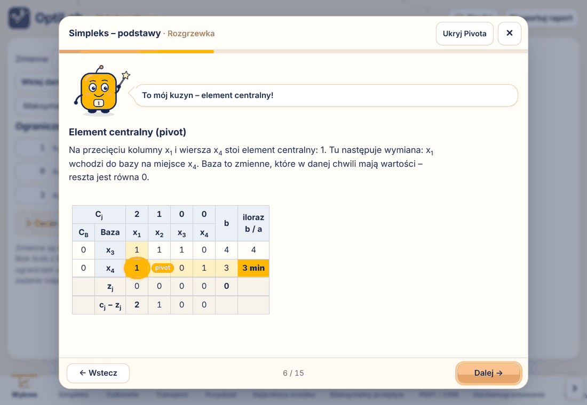 | 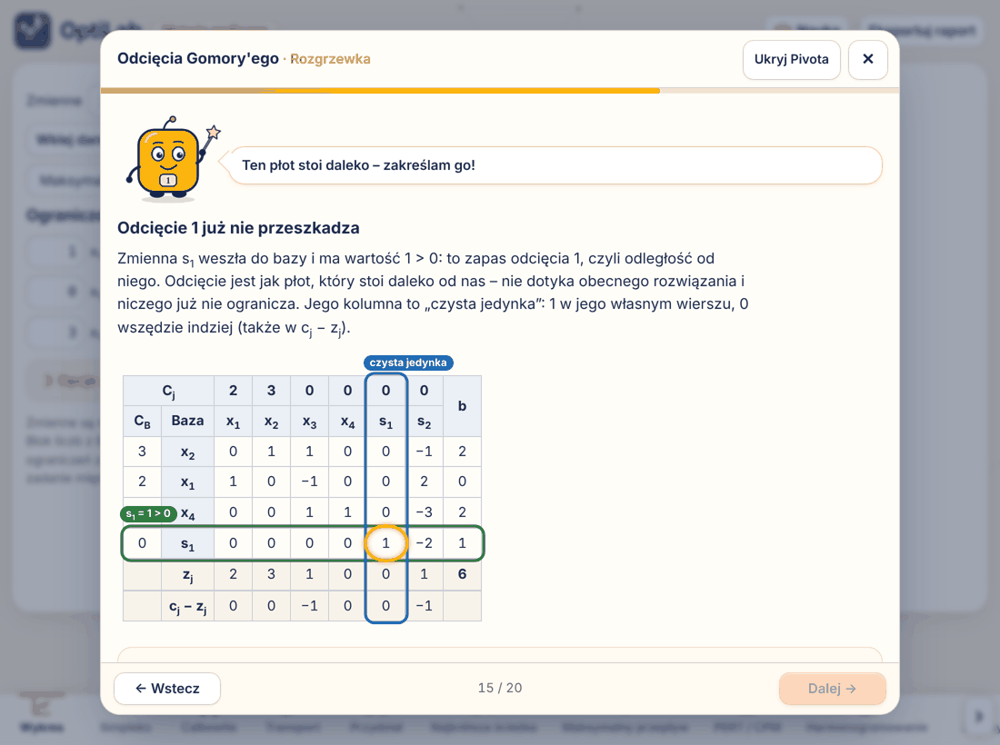 |
| *Simpleks: element centralny* | *Gomory: „płot” daleko – wiersz i kolumna znikną* |

## 🧭 Co znajdziesz w aplikacji

### 📐 Programowanie matematyczne
| | Moduł | Co potrafi |
|---|---|---|
| 📈 | **Metoda graficzna** | obszar dopuszczalny, wierzchołki, prosta celu, punkty całkowite |
| 🧾 | **Simpleks** | tablice krok po kroku: metoda dwufazowa, duże M i alternatywna metoda tabelaryczna (CB, zj, cj − zj, kolumna ilorazów, symboliczne M), zadanie dualne, analiza wrażliwości OFC i RHS (jak w Excel Solver), gotowa interpretacja wyników, eksport tablic do Excela, analiza parametryczna, rozwiązania alternatywne |
| 🔢 | **Programowanie całkowitoliczbowe** | metoda podziału i ograniczeń z drzewem obliczeń oraz **odcięcia Gomory'ego** z dualną metodą simpleks: każde odcięcie rozpisane krok po kroku (wybór wiersza, części ułamkowe, nowe ograniczenie, tablice), do 500 odcięć, dokładne ułamki; szczegóły odcięć można dołączyć do raportu PDF albo je pominąć |

### 🕸️ Modele sieciowe
| | Moduł | Co potrafi |
|---|---|---|
| 🚚 | **Transport** | metody startowe (NW, minimalny element, VAM), MODI z cyklem, degeneracja, trasy zakazane |
| 🧩 | **Przydział** | metoda węgierska krok po kroku, macierze prostokątne, rozwiązania alternatywne |
| 🛣️ | **Najkrótsza ścieżka** | Dijkstra z tabelą etykiet, Bellman-Ford, ujemne cykle |
| 🌊 | **Maksymalny przepływ** | Edmonds-Karp, sieć rezydualna w każdej iteracji, przekrój minimalny |

### 🗓️ Projekt i harmonogram
| | Moduł | Co potrafi |
|---|---|---|
| ⏱️ | **PERT / CPM** | rezerwy, wszystkie ścieżki krytyczne, wykres Gantta, prawdopodobieństwo terminu, skracanie projektu z kosztem, symulacja Monte Carlo |
| 🏭 | **Harmonogramowanie** | reguły SPT, WSPT, EDD, Moore'a-Hodgsona, reguła Johnsona, flow shop (CDS, Palmer, NEH), maszyny równoległe |

### 📦 Zapasy, prognozy i planowanie produkcji
| | Moduł | Co potrafi |
|---|---|---|
| 📦 | **Zapasy** | EOQ, EPQ, braki planowane, rabaty ilościowe, zapas bezpieczeństwa, model gazeciarza, dobór partii (Wagner-Whitin, Silver-Meal i inne) |
| 🔮 | **Prognozowanie** | średnie ruchome, wygładzanie wykładnicze, Holt, Holt-Winters, regresja, miary błędów i sygnał kontrolny, automatyczny dobór parametrów |
| 📊 | **Planowanie zagregowane** | model LP z zatrudnieniem, nadgodzinami i podwykonawstwem, porównanie strategii, ceny dualne |
| 🔩 | **MRP** | wielopoziomowa struktura wyrobu, kody niskiego poziomu, tabele MRP, reguły doboru partii, komunikaty „przyspieszyć / opóźnić" |

### 🎲 Modele probabilistyczne
| | Moduł | Co potrafi |
|---|---|---|
| ⏳ | **Kolejki** | M/M/1, M/M/s, M/M/s/K (Erlang B), M/G/1, M/D/1, M/Eₖ/1, populacja skończona, diagram przejść, optymalna liczba stanowisk |
| 🔗 | **Procesy Markowa** | rozkład po n krokach, rozkład stacjonarny, klasyfikacja stanów, łańcuchy pochłaniające, czasy pierwszego przejścia, czas ciągły |
| 🎰 | **Symulacja kolejek** | symulacja zdarzeń krok po kroku, 6 rozkładów, powtórzenia z przedziałami ufności, porównanie z teorią i konfiguracji między sobą |

### ✅ Decyzje i jakość
| | Moduł | Co potrafi |
|---|---|---|
| 🎯 | **Analiza decyzji** | kryteria Walda, Hurwicza, Laplace'a, Savage'a, EMV, EOL, EVPI, drzewa decyzyjne z rysunkiem, twierdzenie Bayesa i EVSI, użyteczność, gry o sumie zerowej |
| 📉 | **Karty kontrolne** | X̄-R, X̄-s, I-MR, p, np, c, u, reguły Nelsona, faza I, zdolność procesu Cp/Cpk, wykres Pareto, CUSUM, EWMA, ARL |
| 🔍 | **Odbiór statystyczny** | krzywe OC, AOQ, AOQL, ATI, dobór planu dla AQL i LTPD, plany dwustopniowe, plan sekwencyjny SPRT, plany dla cech mierzalnych |

### 🧮 Optymalizacja zaawansowana i lokalizacja
| | Moduł | Co potrafi |
|---|---|---|
| 🎯 | **Programowanie celowe** | cele z odchyleniami d⁻ i d⁺, priorytety (krok po kroku), wagi, minimax, normalizacja, cele całkowitoliczbowe, rysunek dla 2 zmiennych |
| 🪜 | **Programowanie dynamiczne** | ścieżka etapowa (wstecz i w przód), rozdział zasobów, plecak, produkcja i zapasy, wymiana sprzętu – tablice f(s) i polityka optymalna |
| 🥚 | **Programowanie kwadratowe** | wypukłość z wartości własnych, warunki KKT, algorytm Lemkego krok po kroku, mnożniki Lagrange’a, poziomice |
| 〰️ | **Programowanie nieliniowe** | funkcje wpisywane jak w zeszycie (2x1², sin, ln…), złoty podział, Fibonacci, Newton, gradient, BFGS, funkcja kary, rozszerzony Lagrange, ścieżka na poziomicach |
| 📍 | **Lokalizacja i układ** | mediana ważona, Weiszfeld, środek ciężkości z porównaniem kryteriów, układ działów metodą CRAFT, p-mediana, mapy |

## 📸 Jak to wygląda

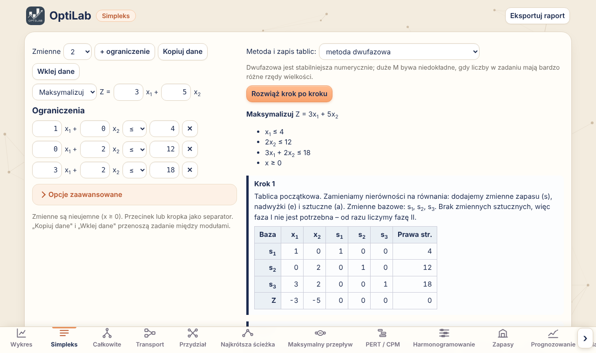

| | |
|---|---|
| 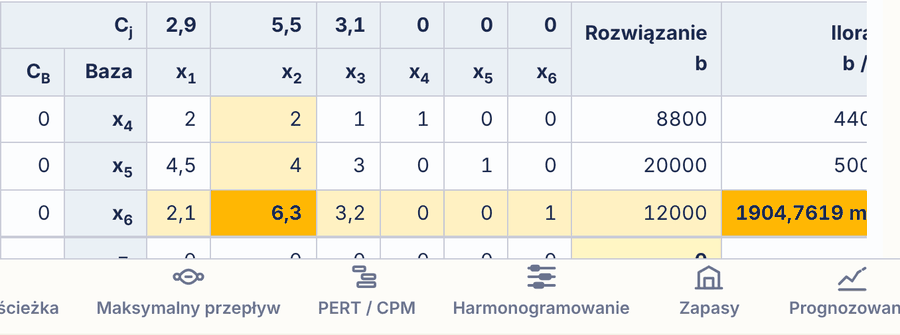 | 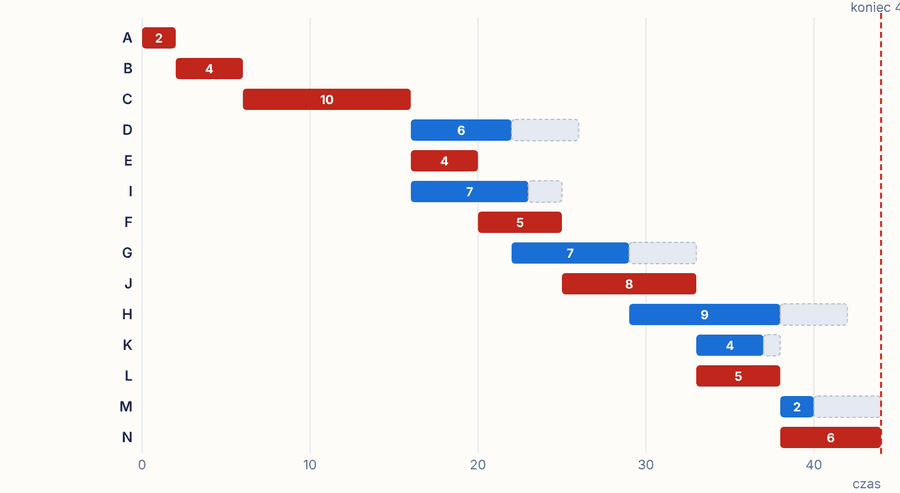 |
| *Simpleks: alternatywna metoda tabelaryczna (cj − zj)* | *PERT/CPM: sieć i ścieżka krytyczna* |
| 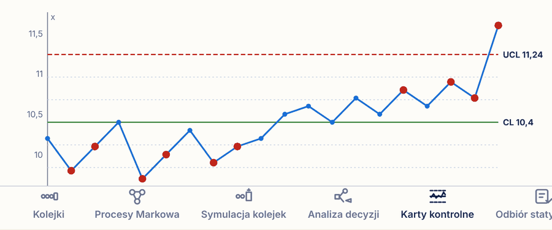 | 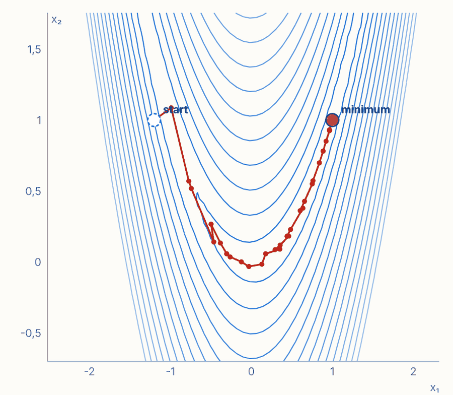 |
| *Karty kontrolne: sygnały reguł Nelsona* | *Programowanie nieliniowe: poziomice i droga metody* |
| 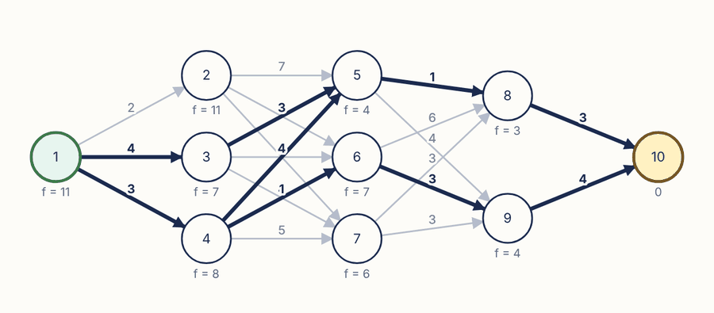 | 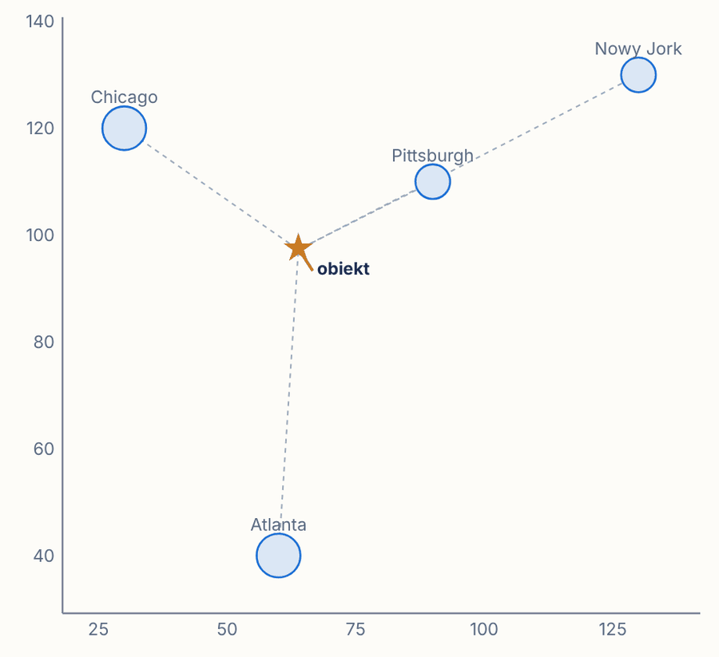 |
| *Programowanie dynamiczne: trasy optymalne* | *Lokalizacja: obiekt, punkty i droga algorytmu Weiszfelda* |
| 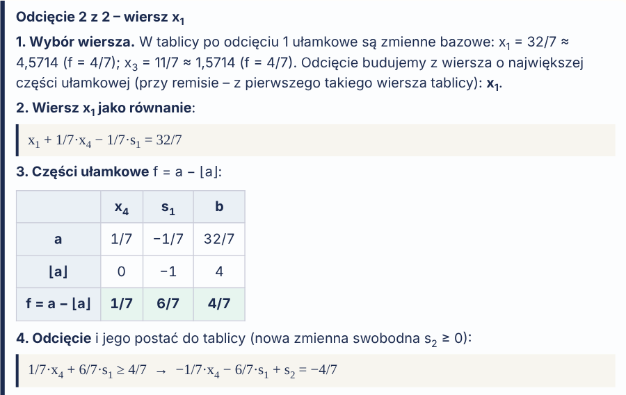 | |
| *Całkowite: odcięcie Gomory'ego krok po kroku – wybór wiersza, części ułamkowe, nowe ograniczenie* | |

## 🚀 Jak zacząć

1. **Otwórz aplikację** i wybierz moduł na dolnym pasku. Na komputerze pasek przewiniesz kółkiem myszy, przeciągnięciem albo strzałkami.
2. **Wczytaj przykład** z „Opcji zaawansowanych" albo wpisz własne dane – możesz je wkleić prosto z Excela: zaznacz komórki w arkuszu, skopiuj (Ctrl+C) i wklej w pole tabeli (Ctrl+V lub przytrzymaj palcem → Wklej).
3. **Kliknij przycisk obliczeń** i przeczytaj raport z krokami. Przycisk **„Eksportuj raport”** zapisze go do PDF, do Worda (.docx) albo wyniki do Excela (.csv).

## 💡 Dlaczego OptiLab, a nie WinQSB?

| | WinQSB | OptiLab |
|---|---|---|
| Uruchomienie | instalacja na Windows | przeglądarka – komputer, tablet, telefon |
| Język | angielski | polski |
| Wyjaśnienia | wynik i wybrane tablice | opis każdego kroku: dlaczego i skąd liczba |
| Dane | własny format plików | wklejanie bloków komórek prosto z Excela do każdej tabeli, CSV (polski Excel), JSON |
| Raport | wydruk | PDF i Word (.docx) z bieżącego modułu – tabele jako prawdziwe tabele, wykresy; wyniki do Excela (.csv) |
| Błędy w danych | ogólny komunikat | czerwone pole i wyjaśnienie, co poprawić |

## ✅ Na wynikach można polegać

- **13 284 automatycznych sprawdzeń** – wszystkie przechodzą.
- Wyniki porównujemy z **przykładami z literatury** (m.in. Hillier i Lieberman, Heizer i Render, Render i Stair, Chopra i Meindl, Montgomery, Taylor) oraz **niezależnymi obliczeniami**: przeglądem wszystkich możliwych rozwiązań, wzorami zamkniętymi i symulacją Monte Carlo.
- Każdy moduł jest sprawdzany w prawdziwej przeglądarce na ekranie komputera i telefonu.
- Gdy wynik nie jest pewny (np. przekroczony limit obliczeń), aplikacja mówi to wprost – **nigdy nie pokazuje niepewnego wyniku jako poprawnego**.

## 📂 Praca z danymi

- 📋 **Wklejanie z Excela** – blok komórek (także z nagłówkami i nazwami wierszy) wklejasz w dowolne pole macierzy lub tabeli; tabela sama się powiększa, a przecinek dziesiętny, spacje w tysiącach i procenty są rozpoznawane. Błędna komórka jest zaznaczona na czerwono z opisem, gdzie leży w schowku – i nic się nie zmienia
- 🔁 **Kopiuj / Wklej dane** – przenoszenie zadań między modułami i urządzeniami; „Wklej dane” przyjmuje też całą tabelę skopiowaną z Excela
- 📊 **Excel (.csv)** – eksport i import w formacie polskiego Excela (średnik, przecinek dziesiętny)
- 💾 **Plik .json** – zapis i wczytanie całego zadania
- 🖨️ **PDF** – raport tylko z bieżącego modułu, tabele nie są rozcinane między stronami; długie tabele przechodzą na kolejne strony z powtórzonym nagłówkiem kolumn – także na iPhonie (Safari)
- 📝 **Word (.docx)** – ten sam raport do edycji: tabele Worda z kolorami raportu i powtarzanym nagłówkiem, ramki z wynikiem, wykresy i sieci jako obrazy
- 📈 **Wyniki do Excela (.csv)** – wszystkie tabele raportu, wynik i komunikaty w jednym pliku dla polskiego Excela

## 🏁 Stan projektu
🎓 **Nowość (listopad 2026): Nauka z Pivotem** – interaktywne lekcje całego programowania liniowego: metoda graficzna, simpleks (z metodą dwufazową i dużym M), odcięcia Gomory'ego i metoda podziału i ograniczeń – każda na trzech poziomach, z pytaniami, wyjaśnieniem błędów i wynikiem Sprawdzianu.

### 🛠️ W przygotowaniu
- 🎓 Lekcje „Nauka” dla kolejnych modułów (np. Transport i Przydział) – silnik lekcji jest gotowy, wystarczy dopisać lekcję dla metody (opis na dole strony).

📋 **Nowość (listopad 2026): wklejanie z Excela i eksport do Worda** – bloki komórek z Excela (tabulator, średnik, przecinek dziesiętny) wkleisz do każdej macierzy i tabeli we wszystkich modułach, a jeden przycisk „Eksportuj raport” zapisuje raport do PDF, do Worda (.docx – tabele jako tabele, nie zrzuty) albo wyniki do Excela (.csv).

🖨️ **Poprawka (listopad 2026): PDF z iPhone'a** – Safari dzieliło długie tabele w połowie wierszy i zostawiało nagłówki na dole strony. Teraz raport sam układa strony: długa tabela przechodzi na następną stronę z powtórzonym nagłówkiem kolumn, a nagłówki zawsze trzymają się swojej treści.

🔢 **Nowość (listopad 2026): odcięcia Gomory'ego krok po kroku** – w zakładce „Całkowite” każde odcięcie jest rozpisane w całości, niezależnie od ich liczby (do 500). Jednym przełącznikiem decydujesz, czy szczegóły trafią do raportu PDF (nawet ponad 100 stron obliczeń), czy wystarczy tabela podsumowania.

🎨 **Nowość (listopad 2026): odświeżony wygląd** – ciepły beż z pastelowym pomarańczem, spokojnie animowane tło-sieć z pomarańczowymi wyładowaniami, czytelniejsze przyciski i „Opcje zaawansowane”. Obliczenia i raporty bez zmian.

Wszystkie moduły WinQSB są gotowe 🎉 – od programowania liniowego po lokalizację i układ. Dalsze prace to dopracowywanie na podstawie uwag użytkowników: jeśli coś liczy się inaczej niż na zajęciach albo raport jest niejasny, zgłoś to razem z danymi zadania.

## 👩‍💻 Dla programistów

Czyste HTML, CSS i JavaScript – bez instalacji zależności i bez bundlera.

**Jak dopisać lekcję „Nauka” dla kolejnej metody:** (1) w pliku `js/lessons/nazwa-lessons.js` napisz czystą funkcję `build(level)` (`warm` / `test` / `challenge`), która rozwiązuje zadanie lekcyjne istniejącym solverem i zwraca listę kart w formacie opisanym na górze `js/lesson.js` – liczby, tabele i poprawne odpowiedzi biorą się z wyniku solvera; (2) zarejestruj temat: `LESSON.register({id, title, group, tabs: ['zakładka'], build})`; (3) dodaj `<script>` po `js/lesson.js` i podnieś `?v=N`; (4) dopisz test jak `tests/lesson.test.js` (format kart, limit kart, każde pytanie porównane z solverem, ostatnia karta = wynik raportu). Postać Pivota zmieniasz tylko w `assets/pivot_maskotka.svg`, potem `python3 tools/pivot_svg.py`.

 Struktura plików i zasady rozwoju: [DOKUMENTACJA-TECHNICZNA.md](DOKUMENTACJA-TECHNICZNA.md). Testy: `node tests/<nazwa>.test.js` (Node 18+), test w przeglądarce: `python3 tests/browser_check.py` (Playwright).

---

Made by Aleksander Kruszelnicki

