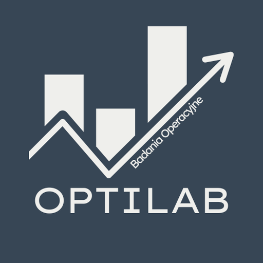

  

<h1 align="center">OptiLab 🧮</h1>

<b>Badania operacyjne w przeglądarce – po polsku, krok po kroku, bez instalacji.</b>

  <a href="https://giorgioulani544.github.io/OptiLab/"><b>👉 Otwórz aplikację</b></a>

  
  
  
  

---

## ✨ Co to jest?

**OptiLab** to darmowa aplikacja do rozwiązywania zadań z badań operacyjnych i zarządzania produkcją – nowoczesna alternatywa dla programu WinQSB. Działa w przeglądarce, na komputerze i na telefonie.

Nie podaje samego wyniku. Pokazuje, **jak do niego dojść**: każdy krok jest opisany po polsku, z tabelami, kolorowymi wyróżnieniami i wykresami. Dlatego nadaje się zarówno do rozwiązywania zadań, jak i do nauki oraz sprawdzania obliczeń wykonanych ręcznie.

## 🧭 Co znajdziesz w aplikacji

### 📐 Programowanie matematyczne
| | Moduł | Co potrafi |
|---|---|---|
| 📈 | **Metoda graficzna** | obszar dopuszczalny, wierzchołki, prosta celu, punkty całkowite |
| 🧾 | **Simpleks** | tablice krok po kroku (dwufazowa i duże M), zadanie dualne, analiza wrażliwości i parametryczna, rozwiązania alternatywne |
| 🔢 | **Programowanie całkowitoliczbowe** | metoda podziału i ograniczeń z drzewem obliczeń |

### 🕸️ Modele sieciowe
| | Moduł | Co potrafi |
|---|---|---|
| 🚚 | **Transport** | metody startowe (NW, minimalny element, VAM), MODI z cyklem, degeneracja, trasy zakazane |
| 🧩 | **Przydział** | metoda węgierska krok po kroku, macierze prostokątne, rozwiązania alternatywne |
| 🛣️ | **Najkrótsza ścieżka** | Dijkstra z tabelą etykiet, Bellman-Ford, ujemne cykle |
| 🌊 | **Maksymalny przepływ** | Edmonds-Karp, sieć rezydualna w każdej iteracji, przekrój minimalny |

### 🗓️ Projekt i harmonogram
| | Moduł | Co potrafi |
|---|---|---|
| ⏱️ | **PERT / CPM** | rezerwy, wszystkie ścieżki krytyczne, wykres Gantta, prawdopodobieństwo terminu, skracanie projektu z kosztem, symulacja Monte Carlo |
| 🏭 | **Harmonogramowanie** | reguły SPT, WSPT, EDD, Moore'a-Hodgsona, reguła Johnsona, flow shop (CDS, Palmer, NEH), maszyny równoległe |

### 📦 Zapasy, prognozy i planowanie produkcji
| | Moduł | Co potrafi |
|---|---|---|
| 📦 | **Zapasy** | EOQ, EPQ, braki planowane, rabaty ilościowe, zapas bezpieczeństwa, model gazeciarza, dobór partii (Wagner-Whitin, Silver-Meal i inne) |
| 🔮 | **Prognozowanie** | średnie ruchome, wygładzanie wykładnicze, Holt, Holt-Winters, regresja, miary błędów i sygnał kontrolny, automatyczny dobór parametrów |
| 📊 | **Planowanie zagregowane** | model LP z zatrudnieniem, nadgodzinami i podwykonawstwem, porównanie strategii, ceny dualne |
| 🔩 | **MRP** | wielopoziomowa struktura wyrobu, kody niskiego poziomu, tabele MRP, reguły doboru partii, komunikaty „przyspieszyć / opóźnić" |

### 🎲 Modele probabilistyczne
| | Moduł | Co potrafi |
|---|---|---|
| ⏳ | **Kolejki** | M/M/1, M/M/s, M/M/s/K (Erlang B), M/G/1, M/D/1, M/Eₖ/1, populacja skończona, diagram przejść, optymalna liczba stanowisk |
| 🔗 | **Procesy Markowa** | rozkład po n krokach, rozkład stacjonarny, klasyfikacja stanów, łańcuchy pochłaniające, czasy pierwszego przejścia, czas ciągły |
| 🎰 | **Symulacja kolejek** | symulacja zdarzeń krok po kroku, 6 rozkładów, powtórzenia z przedziałami ufności, porównanie z teorią i konfiguracji między sobą |

## 🚀 Jak zacząć

1. **Otwórz aplikację** i wybierz moduł na dolnym pasku. Na komputerze pasek przewiniesz kółkiem myszy, przeciągnięciem albo strzałkami.
2. **Wczytaj przykład** z „Opcji zaawansowanych" albo wpisz własne dane – możesz je wkleić prosto z Excela.
3. **Kliknij przycisk obliczeń** i przeczytaj raport z krokami. Jednym kliknięciem zapiszesz go do PDF.

## 💡 Dlaczego OptiLab, a nie WinQSB?

| | WinQSB | OptiLab |
|---|---|---|
| Uruchomienie | instalacja na Windows | przeglądarka – komputer, tablet, telefon |
| Język | angielski | polski |
| Wyjaśnienia | wynik i wybrane tablice | opis każdego kroku: dlaczego i skąd liczba |
| Dane | własny format plików | kopiuj/wklej z Excela, CSV (polski Excel), JSON |
| Raport | wydruk | PDF z bieżącego modułu, czytelne tabele i wykresy |
| Błędy w danych | ogólny komunikat | czerwone pole i wyjaśnienie, co poprawić |

## ✅ Na wynikach można polegać

- **9278 automatycznych sprawdzeń** – wszystkie przechodzą.
- Wyniki porównujemy z **przykładami z literatury** (m.in. Hillier i Lieberman, Heizer i Render, Render i Stair, Chopra i Meindl) oraz **niezależnymi obliczeniami**: przeglądem wszystkich możliwych rozwiązań, wzorami zamkniętymi i symulacją Monte Carlo.
- Każdy moduł jest sprawdzany w prawdziwej przeglądarce na ekranie komputera i telefonu.
- Gdy wynik nie jest pewny (np. przekroczony limit obliczeń), aplikacja mówi to wprost – **nigdy nie pokazuje niepewnego wyniku jako poprawnego**.

## 📂 Praca z danymi

- 📋 **Kopiuj / Wklej dane** – przenoszenie zadań między modułami i urządzeniami
- 📊 **Excel (.csv)** – eksport i import w formacie polskiego Excela (średnik, przecinek dziesiętny)
- 💾 **Plik .json** – zapis i wczytanie całego zadania
- 🖨️ **PDF** – raport tylko z bieżącego modułu, tabele nie są rozcinane między stronami

## 🛠️ W przygotowaniu

Analiza decyzji · Karty kontrolne · Odbiór statystyczny · Programowanie celowe · Programowanie dynamiczne · Programowanie kwadratowe · Programowanie nieliniowe · Lokalizacja i układ

Docelowo OptiLab ma objąć wszystkie moduły WinQSB. Uwagi i zgłoszenia błędów są bardzo mile widziane. 🙌

## 👩‍💻 Dla programistów

Czyste HTML, CSS i JavaScript – bez instalacji zależności i bez bundlera. Struktura plików i zasady rozwoju: [DOKUMENTACJA-TECHNICZNA.md](DOKUMENTACJA-TECHNICZNA.md). Testy: `node tests/<nazwa>.test.js` (Node 18+), test w przeglądarce: `python3 tests/browser_check.py` (Playwright).

---

Made by Aleksander Kruszelnicki

